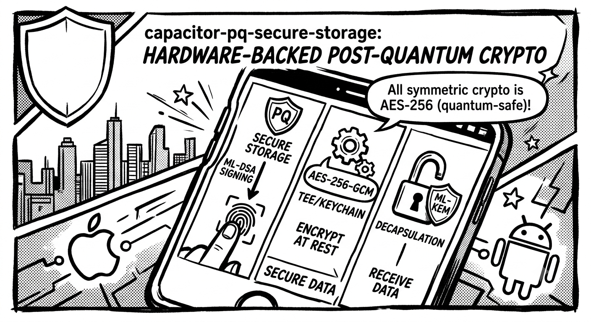

# capacitor-pq-secure-storage

Capacitor plugin for post-quantum signing (ML-DSA), ML-KEM encryption and secure storage on iOS and
Android. Private keys live in the iOS Secure Enclave and the Android Keystore, and can require a
biometric for every use. Both platforms are checked on a phone. On the Android phone tested,
ML-DSA is not available in hardware, see [Verification status](#verification-status).

<p align="center">
  
</p>

<div align="right">
  <a href="https://app.aikido.dev/audit-report/external/s5Dq4JfRbnjJf4DiJVBzlwVZ/request" target="_blank" rel="noopener">
    <picture>
      <source media="(prefers-color-scheme: dark)" srcset="https://app.aikido.dev/assets/badges/full-dark-theme.svg" />
      
    </picture>
  </a>
</div>


## Features

- **ML-DSA signing** (FIPS 204, levels 65/87), with the key in the iOS Secure Enclave or the Android Keystore.
- **ECDSA P-256 and Ed25519 signing**. ECDSA keys are hardware keys. Ed25519 is a software key,
  encrypted at rest by a hardware key.
- **ML-KEM** (FIPS 203, levels 768/1024) for receiving data encrypted to your public key.
- **Encryption at rest**: Secure Enclave ECIES on iOS, AES-256-GCM with a Keystore key in the TEE on Android.
  On iOS 26+ with `format: 2`, the key comes from an ML-KEM-768 key in the Secure Enclave.
- **Self-describing frames** (`format: 2`): a 4-byte header says which algorithm made a blob, and
  reads tell you when to re-encrypt it.
- **Secure storage** (`setItem` / `getItem` / ...), a key-value store where each item can require a biometric.
- **Web fallback** in software (@noble), for development.

## Contents

- [Requirements](#requirements)
- [Platform support](#platform-support)
- [Verification status](#verification-status)
- [Install](#install)
- [Usage](#usage)
  - [Frame formats](#frame-formats)
- [Limits](#limits)
- [Security model](#security-model)
- [API reference](#api-reference)
- [Upgrading](#upgrading)
- [Error codes](#error-codes)
- [Testing](#testing)

## Requirements

| Platform | Minimum | ML-DSA / ML-KEM |
|---|---|---|
| iOS | iOS 15 (CocoaPods or SPM); build with the iOS 26 SDK (Xcode 26+) | iOS 26+ with a Secure Enclave |
| Android | `minSdk 34` (Android 14) | ML-DSA: Android 17+ with ML-DSA in the Keystore (checked at runtime by making a throwaway key). ML-KEM: any supported version (software, BouncyCastle) |
| Web | any | software fallback only |

What works below the ML-DSA / ML-KEM floor:

- **iOS 15 to 25**: secure storage, and encryption at rest (it needs a Secure Enclave). Every
  signing type and ML-KEM reject `E_UNSUPPORTED`, and `getHardwareCapabilities` reports false and
  empty lists, with `atRestSuite` 17 (`0x11`).
- **Android without Keystore ML-DSA**: everything but ML-DSA. `supportsPqc` is false,
  `supportedVariants` lists `ECDSA_256R1` and `ED25519`, and an ML-DSA `generateKeyPair` rejects
  `E_KEYGEN`. `supportsPqc` and the ML-DSA entries of `supportedVariants` come from making and
  deleting a throwaway ML-DSA-65 key, the first time `getHardwareCapabilities` is called after the
  plugin loads. The key has no biometric and no unlock requirement, and the plugin keeps the answer
  (yes or no) in memory until it is reloaded. A biometric ML-DSA key is not tried separately, so it
  can still reject `E_KEYGEN`.
- **Simulator and emulator**: on the iOS simulator the unsigned test build has no Keychain access,
  so signing, ML-KEM keys, the store and at-rest fail there. Android emulators run the store,
  at-rest and ML-KEM, but have no Keystore ML-DSA.

On the **web** there is no secure hardware, so the plugin uses a software backend (@noble) with keys
in `localStorage`. Operations work and `supportsPqc` is `true`, but nothing is hardware-backed or
biometric-gated: `requireBiometric` and `accessibility` are accepted and ignored, and any script on
the page's origin can read the keys. Use it for development or non-critical data only.

## Platform support

| Feature | iOS | Android |
|---|---|---|
| ML-DSA sign | Secure Enclave | Keystore (hardware if KeyMint implements ML-DSA, not yet verified on a device) |
| ECDSA P-256 sign | Secure Enclave | Keystore |
| Ed25519 sign | software key, private in the Keychain (biometric access control with `requireBiometric`) | software key (BouncyCastle), private wrapped by a Keystore AES key |
| ML-KEM decapsulate | Secure Enclave | software (BouncyCastle), private wrapped by a Keystore AES key (TEE) |
| Encryption at rest | Secure Enclave ECIES (P-256 key that never leaves the enclave, AES-GCM inside). With `format: 2` on iOS 26+: AES-256-GCM under a key from a Secure Enclave ML-KEM-768 key | Keystore AES-256-GCM (TEE) |
| Secure storage | one Keychain item per key, per-item access control, plus an index row per item (no access control) so `keys()` can list biometric items | one Keystore AES-256-GCM key per item (StrongBox where available), biometric bound to the item's cipher |

iOS decapsulates ML-KEM inside the Secure Enclave; Android does not, because the Android Keystore
exposes ML-DSA to apps but not ML-KEM (ML-KEM stays in KeyMint / attestation / TLS, not the
app-facing API). On Android the ML-KEM private key is wrapped by an auth-required Keystore AES key
and only unwrapped inside a `BiometricPrompt.CryptoObject`, so a hooked biometric callback cannot
release it (defense against GHSA-vx5f-vmr6-32wf). `kemInSecureEnclave` reports which path a device
uses.

## Verification status

| Platform | Verified on |
|---|---|
| iOS | iPhone 16 / iOS 27.0.1, November 2026, this code. ML-DSA-65 and 87 in the Secure Enclave with Face ID on every sign, ECDSA, Ed25519, the store, at-rest with suite `0x12` (`atRestSuite` 18) and older frames, ML-KEM 768 and 1024, frames shared with the web both ways. Earlier: iPhone 15 Pro / iOS 26, July 2026, on the 7.0.0 / 8.0.0 code. |
| Android | Samsung Galaxy A57 / Android 17, November 2026, this code. The store, at-rest (`0x10`), ML-KEM 768 and 1024, ECDSA and Ed25519, biometric prompts and their cancel paths, frames shared with the web both ways. All keys in the TEE (security level checked); no StrongBox on that phone. ML-DSA does NOT work there: the Keystore rejects every ML-DSA key. |

Three problems found on these phones are fixed in this version: iOS `keys()` did not list
biometric items, Android reported ML-DSA on a phone whose Keystore cannot make the keys, and the
Android `supportedVariants` and `supportedKem` reached JavaScript as a string. The fixes are to be
re-checked on the phones with E6 and A2 of `DEVICE-VERIFICATION.md`.

The full list of checks and their results is in `DEVICE-VERIFICATION.md`, section Results so far.

On Android, read `hardwareBacked` from `getHardwareCapabilities()` at runtime and gate seed-tier
trust on it. It comes from a probe AES key, not from your ML-DSA key, and the plugin does not
request key attestation. Do not assume hardware ML-DSA until you have checked it on your target
device. `DEVICE-VERIFICATION.md` shows how, and lists what is still open.

## Install

Install the line that matches your Capacitor major, then sync:

| Capacitor | Plugin line | npm |
|---|---|---|
| 8 | `8.x` | `npm i capacitor-pq-secure-storage@latest` |
| 7 | `7.x` | `npm i capacitor-pq-secure-storage@cap7` |

The `latest` tag is the Capacitor 8 line and `cap7` the Capacitor 7 line. The peer dependency pins
the Capacitor major, so npm reports a peer conflict when they do not match.

```bash
npx cap sync
```

```ts
import { PqSecureStorage } from 'capacitor-pq-secure-storage';
```

Data fields (`data`, `signature`, `ciphertext`, `plaintext`, `publicKey`, `recipientPublicKey`)
are base64 strings: the standard alphabet (not url-safe), spaces and line breaks are skipped, and
padding is optional. Secure-storage `value` is a raw string; use `setJSON` / `getJSON` to store
typed JSON (objects, arrays, numbers) and get the type back.

### iOS setup

Face ID needs a usage description, or the app crashes on the first prompt. Add to the app's
`Info.plist`:

```xml
<key>NSFaceIDUsageDescription</key>
<string>Authenticate to use your secure keys</string>
```

The plugin ships both CocoaPods and Swift Package Manager (`Package.swift`); `npx cap sync` uses
whichever your app is set up for. The app's iOS deployment target must be 15.0 or later (a
Capacitor 7 app starts at 14.0: raise it in the Xcode project and in `ios/App/Podfile`). Building
needs the iOS 26 SDK (Xcode 26+). The ML-DSA and ML-KEM code is gated with
`@available(iOS 26.0, *)`; see [Requirements](#requirements) for what works below iOS 26.

### Android setup

The plugin needs `minSdk 34`. The Capacitor app template sets a lower `minSdkVersion`, so raise it
in your app's `android/variables.gradle`. Add the biometric permission to the app's
`AndroidManifest.xml`:

```xml
<uses-permission android:name="android.permission.USE_BIOMETRIC" />
```

A prompt needs a `FragmentActivity` as its host (Capacitor's `BridgeActivity` is one), else the
call rejects `E_NO_ACTIVITY`.

Exclude the plugin's prefs from backup (see the backup section below) and set
`android:allowBackup="false"`.

## Usage

### Capabilities

```ts
const caps = await PqSecureStorage.getHardwareCapabilities();
// { supportsPqc, hardwareBacked, biometricGated, supportedVariants, supportedKem, kemInSecureEnclave, atRestSuite }
// check supportedVariants / supportedKem before you pick a type (real arrays on every platform).
// on Android the first call after the plugin loads makes and deletes a throwaway ML-DSA key, so it is slower.
// gate seed-tier trust on hardwareBacked (false on web), not on supportsPqc (true on web too)
```

### Signing

```ts
import { PqSecureStorage, SignatureType } from 'capacitor-pq-secure-storage';

await PqSecureStorage.generateKeyPair({ keyAlias: 'aid-signing', type: SignatureType.MLDSA_65 });
const { publicKey } = await PqSecureStorage.getPublicKey({ keyAlias: 'aid-signing' });
const { signature } = await PqSecureStorage.sign({
  keyAlias: 'aid-signing',
  type: SignatureType.MLDSA_65,
  data: base64Payload,
  description: 'Approve transfer of 10 tokens', // optional prompt text, Face ID does not show it
}); // prompts if the key was made with requireBiometric (the default)
```

`SignatureType` / `KemType` / `Accessibility` are exported both as types and as named
constants, so you can pass `SignatureType.MLDSA_65` instead of the raw `'PQC_MLDSA_65'`
string (plain string literals still work).

Public keys are returned as raw fixed-length bytes (FIPS 203/204), same encoding on iOS and
Android, and that is what `encryptTo`/`recipientPublicKey` expects back. Sizes in bytes:

| Type | Public key | Signature | Private key |
|---|---|---|---|
| `PQC_MLDSA_65` | 1952 | 3309 | hardware |
| `PQC_MLDSA_87` | 2592 | 4627 | hardware |
| `ECDSA_256R1` | 33 (compressed point) | 64 (raw r then s, low-S, over the SHA-256 of `data`) | hardware |
| `ED25519` | 32 | 64 | software, wrapped by a hardware key |

The exported `SIGNATURE_ALGORITHMS` has the same sizes and the CESR codes of each type. ML-KEM
public keys are 1184 bytes (768) and 1568 bytes (1024).

### Encryption at rest

Encrypts and returns the blob; the caller stores it. Not biometric-gated. iOS uses ECIES under a
per-alias Secure Enclave P-256 key (AES-GCM inside), Android an AES-256-GCM key per alias in the
Keystore. On both the key is made on first use, works only while the device is unlocked, and never
leaves the device, so a blob opens only on the device and alias that made it.

```ts
const { ciphertext } = await PqSecureStorage.encryptAtRest({ keyAlias: 'db', data: base64 });
const { plaintext } = await PqSecureStorage.decryptAtRest({ keyAlias: 'db', data: ciphertext });
```

Pass `format: 2` to write a frame that says how it was made (see [Frame formats](#frame-formats)).
You do not pick the algorithm, the platform does, and `atRestSuite` from `getHardwareCapabilities`
tells you which one before you call:

- Android and the web write `0x10`, AES-256-GCM.
- iOS 26+ writes `0x12` when the Secure Enclave can make an ML-KEM-768 key. The first call for an
  alias makes that key and does one encapsulation to it. Both are saved in one Keychain item, about
  2.5 KB (see [Limits](#limits)). Every encrypt and every decrypt then decapsulates in the Secure
  Enclave, and the 32-byte result is the AES-256 key for that call. Like the P-256 key, it never
  prompts and works only while the device is unlocked.
- iOS below 26, or iOS 26+ when the Secure Enclave cannot make that key, writes `0x11`: the ECIES
  output of the plain frame with the header in front.

`decryptAtRest` opens both formats and returns `outdated`. It is `true` for a plain frame and for a
suite other than `atRestSuite`, so you know which blobs to encrypt again:

```ts
const { plaintext, outdated } = await PqSecureStorage.decryptAtRest({ keyAlias: 'db', data: stored });
if (outdated) {
  const { ciphertext } = await PqSecureStorage.encryptAtRest({ keyAlias: 'db', data: plaintext, format: 2 });
  save(ciphertext); // your storage, the plugin keeps nothing
}
```

The P-256 key of an alias stays after a move to `0x12`, because older frames still need it. The
plugin has no call to delete it.

On iOS, `E_KEY_NOT_FOUND` from `decryptAtRest` can be temporary. A Keychain item that cannot be read
right now (for example the device is locked) counts as absent, and a `0x12` frame whose ML-KEM item is
absent rejects `E_KEY_NOT_FOUND` even when the P-256 key exists. Try again once the device is
unlocked before you treat the key as lost.

### ML-KEM

```ts
import { PqSecureStorage, KemType } from 'capacitor-pq-secure-storage';

await PqSecureStorage.generateKemKeyPair({ keyAlias: 'inbox', type: KemType.MLKEM_1024 });
const { publicKey } = await PqSecureStorage.getKemPublicKey({ keyAlias: 'inbox' });

// sender side (software, no key/biometric):
const { ciphertext } = await PqSecureStorage.encryptTo({
  recipientPublicKey: publicKey,
  type: KemType.MLKEM_1024,
  data: base64,
});

// recipient side (decapsulates in the SEP on iOS, TEE-wrapped key on Android):
const { plaintext } = await PqSecureStorage.decrypt({
  keyAlias: 'inbox',
  type: KemType.MLKEM_1024,
  data: ciphertext,
}); // prompts if the key was made with requireBiometric (the default)
```

The frame without a header (v1, the default) is the same on every platform: the ML-KEM ciphertext
(1088 bytes for 768, 1568 for 1024), a 12-byte nonce, then the ChaCha20-Poly1305 ciphertext and tag,
keyed with the raw FIPS 203 shared secret (no KDF, no associated data). So a sender can also build it
with any FIPS 203 library. With `format: 2` the same frame gets a 4-byte header in front, see
[Frame formats](#frame-formats). `encryptTo` does not say who sent a frame: sign the payload if the
recipient must know.

### Frame formats

By default `encryptTo` and `encryptAtRest` return a plain frame (v1): nothing in it says which
algorithm made it. With `format: 2` they return a v2 frame, which starts with a 4-byte header. A later
release can then change an algorithm and still read what is stored, because every frame says what it
is. A missing or null `format` is 1, and the output then has the same layout and size as in earlier
versions. Any value other than 1 or 2 rejects `E_INVALID_ARGS`.

The header:

| Bytes | Value | Meaning |
|---|---|---|
| 0 to 1 | `50 51` | the mark, `PQ` in ASCII |
| 2 | `02` | format version |
| 3 | suite id | what made the frame, see below |

The suites:

| Id | Method | Body after the header | Written with `format: 2` by |
|---|---|---|---|
| `0x01` | `encryptTo` | ML-KEM-768 ciphertext (1088), nonce (12), ChaCha20-Poly1305 ciphertext, tag (16). Key: the FIPS 203 shared secret | every platform, for `PQC_MLKEM_768` |
| `0x02` | `encryptTo` | the same with ML-KEM-1024 (ciphertext 1568) | every platform, for `PQC_MLKEM_1024` |
| `0x10` | `encryptAtRest` | nonce (12), AES-256-GCM ciphertext, tag (16). Key: the alias key in the Keystore (Android) or in `localStorage` (web) | Android, web |
| `0x11` | `encryptAtRest` | the ECIES output of the plain frame, under the Secure Enclave P-256 key of the alias | iOS below 26, and iOS 26+ when the Secure Enclave cannot make an ML-KEM-768 key |
| `0x12` | `encryptAtRest` | the same body as `0x10`. Key: one Secure Enclave ML-KEM-768 decapsulation per call | iOS 26+ |

`0x01` to `0x0F` are for `encryptTo` and `0x10` to `0x1F` for `encryptAtRest`. The rest is reserved.
The table is exported as `FRAME_SUITES` (with `FrameSuite` and `parseFrameHeader`) for anyone who
wants to look at a frame. In `encryptTo` the suite comes from `type`. In `encryptAtRest` the platform
chooses it and you cannot ask for another: `atRestSuite` says which one this device writes. On iOS
26+ the plugin checks that: it makes a throwaway Secure Enclave ML-KEM-768 key and runs one
encapsulation and one decapsulation with it, and nothing is stored. A success is kept for the rest of
the process. A check that fails (for example while the device is locked) runs again on the next call,
so `atRestSuite` and what `format: 2` writes always agree.

Each platform opens only its own at-rest suites: Android and the web `0x10`, iOS `0x11` and, from iOS
26, `0x12`. Any other suite rejects `E_DECRYPT`.

Every suite except `0x11` uses the four header bytes as the associated data of its AEAD, so a changed
version or suite makes the tag fail. `0x11` cannot: the Secure Enclave ECIES call takes no associated
data, so its header is not authenticated. That does not open anything. Someone who edits the header
of a `0x11` frame only sends it down another way of reading, and that way fails. The ECIES body keeps
its own authentication, so the plaintext cannot change.

How a frame is read, by `decrypt` and `decryptAtRest`. You do not say which format it is:

1. If it starts with `50 51 02`, the suite is known, the suite belongs to the method (`0x01` to `0x0F`
   for `decrypt`, `0x10` to `0x1F` for `decryptAtRest`) and this device can open it, it is tried as v2.
   For `decrypt` the suite must also match `type`. If that works, you get the plaintext.
2. Otherwise, or if that fails, the whole frame is tried as v1.
3. If both fail, the error is `E_UNSUPPORTED` when the frame starts with `50 51` and the version is not
   `02`, or the version is `02` and the suite is not known. That is most likely a frame from a newer
   version of the plugin. For any other frame the error is the one earlier versions gave
   (`E_DECRYPT`, `E_BAD_CIPHERTEXT`, and on Android `E_CRYPTO` after a biometric prompt).

The second step is needed because a v1 frame can start with `50 51 02` by chance (1 in 2^24, for
`encryptTo` and for at rest on Android and the web), and it would never open without it. An iOS
v1 at-rest frame starts with `04`, so it never clashes. A key that needs a biometric prompts once for
both tries. The minimum length check of `decrypt` (`E_BAD_CIPHERTEXT`) is still the v1 one.

`outdated` tells an app when to write a frame again. `decrypt` returns `true` when the frame was read
as v1. `decryptAtRest` returns `true` when it was read as v1 or when its suite is not `atRestSuite`,
the one this device writes today. To move stored data to the current format:

1. Read the frame with `decrypt` or `decryptAtRest`.
2. If `outdated` is `true`, encrypt the plaintext again with `format: 2`.
3. Store the new frame in place of the old one.

The plugin never does this for you, because the app owns the stored frames. An iPhone that goes from
iOS 25 to 26 starts to report its `0x11` frames as outdated, and they move to `0x12` the same way. An
app that never passes `format: 2` sees `outdated: true` on every read. That is only information and
changes nothing.

```ts
const { ciphertext } = await PqSecureStorage.encryptTo({
  recipientPublicKey: publicKey,
  type: KemType.MLKEM_1024,
  data: base64,
  format: 2,
});
const { plaintext, outdated } = await PqSecureStorage.decrypt({
  keyAlias: 'inbox',
  type: KemType.MLKEM_1024,
  data: ciphertext,
}); // outdated: false
```

Frames made with `format: 2` do not open on 7.2.0 or earlier. Check what the reader runs before you
send one.

### Secure storage

Key-value store the plugin persists for you. Whether a read prompts is chosen **per item at write
time** with `requireBiometric` (default `false`):

```ts
// silent tier (default): reads never prompt (a drop-in for a plain secure store)
await PqSecureStorage.setItem({ key: 'db-key', value: dbKey });
const { value } = await PqSecureStorage.getItem({ key: 'db-key' }); // no prompt; null if absent

// biometric tier: reads and deletes prompt; writes prompt on Android, and on iOS when replacing
await PqSecureStorage.setItem({ key: 'seed-phrase', value: seedString, requireBiometric: true });
const { value: seed } = await PqSecureStorage.getItem({ key: 'seed-phrase' }); // prompts

const { exists } = await PqSecureStorage.hasItem({ key: 'seed-phrase' });
const { keys } = await PqSecureStorage.keys();
await PqSecureStorage.removeItem({ key: 'seed-phrase' }); // prompts only if the item is biometric
await PqSecureStorage.clear(); // prompts once if any biometric item exists
```

For typed values use `setJSON` / `getJSON` (a JSON round-trip over `setItem` / `getItem`, same
options and tiering; `Date` values round-trip, nested included). Pass the expected type on read:

```ts
await PqSecureStorage.setJSON({ key: 'profile', value: { id: 7, roles: ['admin'] } });
const { value } = await PqSecureStorage.getJSON<{ id: number; roles: string[] }>({ key: 'profile' });
// value: { id: number; roles: string[] } | null
```

Namespace keys with `withPrefix` so `keys()` and `clear()` only touch your own items (useful when
a library shares the store with its host app). Each view keeps its own prefix, so one caller cannot
change another's:

```ts
const mine = PqSecureStorage.withPrefix('mylib_'); // prepended to every key; keys() strips it back
await mine.setItem({ key: 'token', value: 'abc' });
await mine.clear(); // only the items under mylib_
```

`clear()` on a view removes item by item, with one prompt per biometric item. It keeps going after a
cancelled or failed one and rejects at the end with the first error. The items that were not removed
stay in the store. It finds the items with `keys()`, which lists biometric items on iOS too. A
biometric item saved by an earlier version is listed only after one `getItem` or `setItem` on it,
and until then a view's `clear()` leaves it (a plain `clear()` removes it). See
[Upgrading](#upgrading).

Only store keys get the prefix, and it counts toward the 512-unit key limit. Key aliases (signing,
KEM, at-rest) are shared by every caller. A prefix is a plain string prefix: a view on `app_` also
sees the items of a view on `app_lib_`, so pick prefixes that do not start with one another.
`withPrefix` throws a `TypeError` for an empty or non-string prefix.

`setKeyPrefix` / `getKeyPrefix` still work but are deprecated: they change one prefix shared by every
caller that imports the module, the host app included.

Notes:

- `getItem` on a missing key resolves `{ value: null }`, it does not throw.
- Each item is encrypted under its OWN hardware key (Android Keystore AES-256-GCM, StrongBox where
  available; iOS one Keychain item per key). The item's key carries its `requireBiometric` and
  `accessibility`, so both are enforced per item by the platform and can't be downgraded by tampering.
- A biometric READ prompts on both platforms. A biometric WRITE prompts on Android every time; on
  iOS creating the item is silent and replacing its value prompts. To change an item's
  `requireBiometric`, `removeItem` first; overwriting with a different value rejects `E_TIER_MISMATCH`.
- Secrets are this-device-only: they do not move to another device through a backup or a device
  transfer. On Android, also exclude the prefs files from backup (below).
- On iOS each item has an index row in the Keychain (service `pq.securestorage.index`). It has no
  access control, so `keys()` can list it without a prompt, and iOS hides the biometric items
  themselves from that listing. It holds a one-byte value, the same keyed-hash account as the item and
  the same encrypted name, so it shows how many items there are but not their names. `setItem`
  writes it after the item (a create is undone and rejects `E_ENCRYPT` if the row cannot be
  written), `getItem` adds a missing row, `removeItem` deletes it after the item, and `clear()`
  deletes all of them, also when the store is empty (then it deletes only the rows, never a store
  item without the biometric check).

#### Android backup exclusion

Backup rules live in the host app, not the library. Exclude the plugin's prefs files (store, KEM keys, signing keys) in your app's
`data_extraction_rules.xml`:

```xml
<data-extraction-rules>
  <cloud-backup>
    <exclude domain="sharedpref" path="pq_secure_store.xml"/>
    <exclude domain="sharedpref" path="pq_kem.xml"/>
    <exclude domain="sharedpref" path="pq_sig.xml"/>
  </cloud-backup>
  <device-transfer>
    <exclude domain="sharedpref" path="pq_secure_store.xml"/>
    <exclude domain="sharedpref" path="pq_kem.xml"/>
    <exclude domain="sharedpref" path="pq_sig.xml"/>
  </device-transfer>
</data-extraction-rules>
```

The per-item keys never leave the Keystore, so a leaked backup is still useless off-device; the
exclusion is defense in depth. Also set `android:allowBackup="false"` in the host app so the
prefs cannot be pulled/edited via `adb backup`/`restore`.

## Limits

| What | Limit | Past it |
|---|---|---|
| Key alias | 1 to 64 characters from `A-Z a-z 0-9 _ -`, not starting with `__pq` | `E_BAD_ALIAS` |
| Store `key` | 1 to 512 UTF-16 units, the `withPrefix` prefix included | `E_INVALID_ARGS` |
| Store `value` | 256K (262,144) UTF-16 units | `E_INVALID_ARGS` |
| `data` of the crypto calls | 10 MiB after base64 decoding | `E_INPUT_TOO_LARGE` |
| `recipientPublicKey` | 2200 base64 characters (the largest ML-KEM key is 2092) | `E_INVALID_ARGS` |
| `description` of `sign` | 200 characters (on iOS a blank one gets the default prompt text) | cut |
| Android store | 512 items and 16 MiB of stored text | `E_STORE_FULL` |
| Android ML-KEM aliases | 256 | `E_STORE_FULL` |
| Android Ed25519 aliases | 256 | `E_STORE_FULL` |
| v2 frame overhead | 32 bytes per frame (`0x10`, `0x12`), about 85 bytes (`0x11`), 4 bytes more than v1 (`encryptTo`) | none, it only adds to the size |
| iOS `0x12` key material | about 2.5 KB in the Keychain per alias (2577 bytes on an iPhone 16 / iOS 27), made once | none |
| Frames per AES at-rest key (Android, web, iOS `0x12`) | 2^32 (12-byte random nonce) | not enforced |

Hardware signing keys (ML-DSA, ECDSA) have no cap in the plugin, and iOS and the web have no store
cap beyond the per-item bounds. There is no call to delete a signing, KEM or at-rest key. Signing
and KEM keys can be replaced with `overwrite: true`.

## Security model

The plugin treats the JS in the webview as untrusted. What it is built to resist:

- **Hostile JS on the bridge** (an XSS, a bad dependency). It can call every method, but it cannot
  read a private key, and it cannot use a biometric key or item without a real biometric match.
- **A copy of the app's files or of a backup.** Private keys stay in the Secure Enclave or the
  Keystore, and store values and wrapped keys are encrypted under keys that never leave the device.
- **A quantum computer, for data at rest on iOS.** With `atRestSuite` `0x12` and `format: 2`, the
  at-rest key comes from ML-KEM-768 in the Secure Enclave, so `encryptAtRest` on iOS does not depend on
  classical public-key crypto. Frames written before (plain or `0x11`) still do, until you encrypt
  them again. `0x11` does not authenticate its header, see [Frame formats](#frame-formats).

What it does not protect against:

- **Silent keys and items.** With `requireBiometric: false`, any JS on the bridge can use them while
  the device is unlocked. Use `requireBiometric: true` for seed-tier secrets.
- **Plaintext handed to JS.** What `getItem`, `decrypt` and `decryptAtRest` return is visible to any
  JS in the webview.
- **What gets signed.** `sign` signs the bytes it gets. `description` is prompt text set by the
  caller, not proof of the payload, and Face ID does not show it. The same goes for the text that
  warns about a key downgrade. Show your own confirmation for payloads you did not build.
- **A rooted or jailbroken device.** It is not the threat the plugin is built for. One known gap: on
  iOS the prompts before a destructive call (overwriting a biometric key or item, `removeItem` /
  `clear` of biometric items) are a plain `LAContext` check, which a hooked `LAContext` passes
  without a real match. Android binds every biometric gate to a key operation
  (`BiometricPrompt.CryptoObject`), and on iOS the Secure Enclave checks the biometric itself when a
  key is used.
- **Software keys in memory.** ML-KEM decapsulation on Android and Ed25519 signing on both platforms
  run in software: the private key is in app memory for the length of the call. The same goes for the
  `0x12` at-rest key on iOS 26+: the Secure Enclave hands back the AES-256 key of the alias on each
  call, and the plugin keeps it only until the call ends. The web keeps its at-rest key in JS memory
  too. On Android the at-rest key stays in the Keystore, and the AES-GCM runs there.
- **A change of the biometric enrollment.** Biometric keys and items are bound to the current set of
  fingerprints or faces. When it changes (for example a new fingerprint), they can never be used
  again. Keys cannot be exported or backed up, so keep a recovery path, for example a seed phrase
  the user writes down.
- **Sender identity.** `encryptTo` frames are anonymous: anyone with the public key can make one.

## API reference

<docgen-index>

* [`getHardwareCapabilities()`](#gethardwarecapabilities)
* [`generateKeyPair(...)`](#generatekeypair)
* [`getPublicKey(...)`](#getpublickey)
* [`sign(...)`](#sign)
* [`encryptAtRest(...)`](#encryptatrest)
* [`decryptAtRest(...)`](#decryptatrest)
* [`generateKemKeyPair(...)`](#generatekemkeypair)
* [`getKemPublicKey(...)`](#getkempublickey)
* [`encryptTo(...)`](#encryptto)
* [`decrypt(...)`](#decrypt)
* [`setItem(...)`](#setitem)
* [`getItem(...)`](#getitem)
* [`removeItem(...)`](#removeitem)
* [`hasItem(...)`](#hasitem)
* [`keys()`](#keys)
* [`clear()`](#clear)
* [Interfaces](#interfaces)
* [Type Aliases](#type-aliases)

</docgen-index>

<docgen-api>
<!--Update the source file JSDoc comments and rerun docgen to update the docs below-->

### getHardwareCapabilities()

```typescript
getHardwareCapabilities() => Promise<HardwareCapabilities>
```

Report what post-quantum crypto this device supports.

**Returns:** <code>Promise&lt;<a href="#hardwarecapabilities">HardwareCapabilities</a>&gt;</code>

--------------------


### generateKeyPair(...)

```typescript
generateKeyPair(options: { keyAlias: string; type: SignatureType; overwrite?: boolean; requireBiometric?: boolean; }) => Promise<{ publicKey: string; }>
```

Generate a signing keypair under an alias and return the raw public key. ML-DSA and ECDSA
P-256 keys are made in the Secure Enclave (iOS) or the Keystore (Android). Ed25519 is a
software key whose private is encrypted by a hardware key and opened only to sign. Rejects if
the alias exists unless `overwrite` is true. Distinct aliases give independent keypairs (use
that for KERI rotation, one alias per key). On Android an ML-DSA type on a device without
Keystore ML-DSA rejects `E_KEYGEN`: check `supportedVariants` first. That list is tested with a
key without biometric, so a biometric key (the default) can still reject `E_KEYGEN`.

`requireBiometric` (default `true`) is baked into the key: `true` makes every `sign` prompt
for a biometric (per-operation, hardware-enforced); `false` lets the key sign silently while
the device is unlocked. It cannot be changed after creation. Creating a key is silent, except
a biometric Ed25519 key on Android, which prompts. Overwriting a biometric key prompts (a
silent one overwrites silently). When the new key drops the biometric gate the
prompt says so on Android and Touch ID, but Face ID does not show this text (no dialog on a
first-try success), so confirm a downgrade in your own UI before calling. `overwrite` and
`requireBiometric` must be booleans when given; anything else rejects `E_INVALID_ARGS`. On
Android a new wrapped Ed25519 alias past 256 existing ones rejects `E_STORE_FULL`. On Android
and iOS, `requireBiometric: true` with no usable biometric rejects `E_BIOMETRY_UNAVAILABLE`
before anything is created.

| Param         | Type                                                                                                                                  |
| ------------- | ------------------------------------------------------------------------------------------------------------------------------------- |
| **`options`** | <code>{ keyAlias: string; type: <a href="#signaturetype">SignatureType</a>; overwrite?: boolean; requireBiometric?: boolean; }</code> |

**Returns:** <code>Promise&lt;{ publicKey: string; }&gt;</code>

--------------------


### getPublicKey(...)

```typescript
getPublicKey(options: { keyAlias: string; }) => Promise<{ publicKey: string; }>
```

Return the raw public key for an existing signing alias. An alias backs a single key:
generating a hardware key (ML-DSA / ECDSA) under an alias that holds a wrapped Ed25519 key, or
the reverse, rejects `E_ALIAS_EXISTS` even with `overwrite`.

| Param         | Type                               |
| ------------- | ---------------------------------- |
| **`options`** | <code>{ keyAlias: string; }</code> |

**Returns:** <code>Promise&lt;{ publicKey: string; }&gt;</code>

--------------------


### sign(...)

```typescript
sign(options: { keyAlias: string; data: string; type: SignatureType; description?: string; }) => Promise<{ signature: string; }>
```

Sign data with the aliased key. `type` must be the key's type, else `E_TYPE_MISMATCH`.
Prompts for biometrics only if the key was created with `requireBiometric: true` (the
default); a silent key signs with no prompt. ECDSA signs the SHA-256 of `data` and returns raw
r||s (64 bytes, low-S). WARNING: the signature covers the raw `data` bytes as-is and
`description` is only prompt text (the caller controls both), so this is NOT a WYSIWYG consent
guarantee. A host app that signs untrusted payloads must show its own confirmation.
`description` is cut to 200 characters. Android shows it as the prompt subtitle and Touch ID
as the reason, but Face ID does not show it. Rejects `E_INPUT_TOO_LARGE` if `data` exceeds
10 MiB.

| Param         | Type                                                                                                                     |
| ------------- | ------------------------------------------------------------------------------------------------------------------------ |
| **`options`** | <code>{ keyAlias: string; data: string; type: <a href="#signaturetype">SignatureType</a>; description?: string; }</code> |

**Returns:** <code>Promise&lt;{ signature: string; }&gt;</code>

--------------------


### encryptAtRest(...)

```typescript
encryptAtRest(options: { keyAlias: string; data: string; format?: FrameFormat; }) => Promise<{ ciphertext: string; }>
```

Encrypt data with an AES-256-GCM key in the Keystore (Android) or with ECIES under a Secure
Enclave P-256 key (iOS, AES-GCM inside); the web fallback keeps an AES key in localStorage.
The key is made per alias on first use, works only while the device is unlocked, and never
prompts. Returns the blob to store; it opens only on the same device and alias. Rejects
`E_INPUT_TOO_LARGE` if `data` exceeds 10 MiB.

`format` (default `1`) picks the frame: `1` is the plain frame of every earlier version, `2`
puts a 4-byte header (`PQ`, version, suite) in front so a later release can change the
algorithm without breaking stored data. Any other value rejects `E_INVALID_ARGS`. You do not
pick the suite, the platform does: `atRestSuite` in `getHardwareCapabilities` says which one.
On iOS 26+ with `atRestSuite` `0x12` the key is derived from an ML-KEM-768 key in the Secure
Enclave. The `0x11` suite does not authenticate its header.

| Param         | Type                                                                                              |
| ------------- | ------------------------------------------------------------------------------------------------- |
| **`options`** | <code>{ keyAlias: string; data: string; format?: <a href="#frameformat">FrameFormat</a>; }</code> |

**Returns:** <code>Promise&lt;{ ciphertext: string; }&gt;</code>

--------------------


### decryptAtRest(...)

```typescript
decryptAtRest(options: { keyAlias: string; data: string; }) => Promise<{ plaintext: string; outdated: boolean; }>
```

Decrypt a blob produced by `encryptAtRest` under the same alias, in either format. Rejects
`E_INPUT_TOO_LARGE` if `data` exceeds 10 MiB, and `E_UNSUPPORTED` if the blob looks like a
frame from a newer version of the plugin.

`outdated` is `true` when the blob was read as a plain (format 1) frame or its suite is not
the current `atRestSuite`. Re-encrypt it with `format: 2` and store it again to migrate. An
app that never passes `format: 2` will see `outdated: true` on every read.

| Param         | Type                                             |
| ------------- | ------------------------------------------------ |
| **`options`** | <code>{ keyAlias: string; data: string; }</code> |

**Returns:** <code>Promise&lt;{ plaintext: string; outdated: boolean; }&gt;</code>

--------------------


### generateKemKeyPair(...)

```typescript
generateKemKeyPair(options: { keyAlias: string; type: KemType; overwrite?: boolean; requireBiometric?: boolean; }) => Promise<{ publicKey: string; }>
```

Generate an ML-KEM keypair under an alias and return the raw public key. Rejects if the alias
exists unless `overwrite` is true. `requireBiometric` (default `true`) is baked into the key:
`true` makes every `decrypt` prompt; `false` decrypts silently while the device is unlocked.
On Android creating a biometric key prompts; on iOS creation is silent.
Overwriting a biometric key prompts. When the new key drops the biometric gate the prompt says
so on Android and Touch ID, but Face ID does not show this text (no dialog on a first-try
success), so confirm a downgrade in your own UI before calling. On Android a new alias past
256 existing ones rejects `E_STORE_FULL`. On Android and iOS, `requireBiometric: true` with
no usable biometric rejects `E_BIOMETRY_UNAVAILABLE` before anything is created.

| Param         | Type                                                                                                                      |
| ------------- | ------------------------------------------------------------------------------------------------------------------------- |
| **`options`** | <code>{ keyAlias: string; type: <a href="#kemtype">KemType</a>; overwrite?: boolean; requireBiometric?: boolean; }</code> |

**Returns:** <code>Promise&lt;{ publicKey: string; }&gt;</code>

--------------------


### getKemPublicKey(...)

```typescript
getKemPublicKey(options: { keyAlias: string; }) => Promise<{ publicKey: string; }>
```

Return the raw ML-KEM public key for an alias. Android and iOS verify an integrity tag over the stored key (a keyed HMAC on Android, a Secure Enclave signature on iOS) and reject `E_TAMPERED` on a mismatch; the web fallback has no such tag.

| Param         | Type                               |
| ------------- | ---------------------------------- |
| **`options`** | <code>{ keyAlias: string; }</code> |

**Returns:** <code>Promise&lt;{ publicKey: string; }&gt;</code>

--------------------


### encryptTo(...)

```typescript
encryptTo(options: { recipientPublicKey: string; type: KemType; data: string; format?: FrameFormat; }) => Promise<{ ciphertext: string; }>
```

Encrypt data to a recipient's raw ML-KEM public key. Pure software, no alias or biometrics.
The frame is the ML-KEM ciphertext, a 12-byte nonce, then the ChaCha20-Poly1305 output, keyed
with the raw FIPS 203 shared secret. It is the same on every platform, so a frame made on one
opens on another.
It does not say who sent it; sign the payload if the recipient must know. Rejects
`E_INPUT_TOO_LARGE` if `data` exceeds 10 MiB.

`format` (default `1`) picks the frame: `1` is the plain frame described above, `2` puts a
4-byte header (`PQ`, version, suite from `type`) in front and authenticates it with the
ChaCha20-Poly1305 tag. Any other value rejects `E_INVALID_ARGS`.

| Param         | Type                                                                                                                                              |
| ------------- | ------------------------------------------------------------------------------------------------------------------------------------------------- |
| **`options`** | <code>{ recipientPublicKey: string; type: <a href="#kemtype">KemType</a>; data: string; format?: <a href="#frameformat">FrameFormat</a>; }</code> |

**Returns:** <code>Promise&lt;{ ciphertext: string; }&gt;</code>

--------------------


### decrypt(...)

```typescript
decrypt(options: { keyAlias: string; type: KemType; data: string; }) => Promise<{ plaintext: string; outdated: boolean; }>
```

Decrypt data addressed to the aliased ML-KEM key, in either format. Prompts for biometrics
only if the key requires it, once per call. Rejects `E_INPUT_TOO_LARGE` if `data` exceeds
10 MiB, and `E_UNSUPPORTED` if the frame looks like one from a newer version of the plugin.

`outdated` is `true` when the frame was read as a plain (format 1) frame. Re-encrypt it with
`format: 2` to migrate. An app that never passes `format: 2` will see `outdated: true` on
every read.

| Param         | Type                                                                                   |
| ------------- | -------------------------------------------------------------------------------------- |
| **`options`** | <code>{ keyAlias: string; type: <a href="#kemtype">KemType</a>; data: string; }</code> |

**Returns:** <code>Promise&lt;{ plaintext: string; outdated: boolean; }&gt;</code>

--------------------


### setItem(...)

```typescript
setItem(options: { key: string; value: string; requireBiometric?: boolean; accessibility?: Accessibility; }) => Promise<void>
```

Store a secret string under a key. `value` is stored verbatim. Each item is encrypted under
its OWN hardware key (iOS Keychain item / Android Keystore AES-256-GCM key, StrongBox-backed
where available), so the flags below are enforced per item by the platform.

`requireBiometric` (default `false`): `false` reads without a prompt (drop-in for a plain
secure store); `true` gates the item behind a device biometric. A `true` READ prompts on both
platforms. A `true` WRITE prompts on Android every time (the item's own key gates the
encrypt); on iOS creating the item is silent and replacing its value prompts. An item's tier
is fixed when it's created; to change `requireBiometric`, remove the item first (setItem on an
existing item with a different value rejects `E_TIER_MISMATCH`).

WARNING: a silent item is readable by any code on the JS bridge after device unlock (no
prompt), so for seed-tier material (mnemonic, signing seed) pass `requireBiometric: true`.
The silent default exists for drop-in migration, not because silent is safe for secrets.

`accessibility` (default `whenUnlockedThisDeviceOnly`) sets when the item is reachable, honored
per item on both platforms (set when the item is first created).

The item NAME is not stored in the clear: the Android prefs key and the iOS Keychain account
are a keyed hash of the name, so a reader of the raw store sees neither values nor names.
`key` is 1 to 512 UTF-16 units and `value` at most 256K units, else `E_INVALID_ARGS`. The
Android store holds at most 512 items and 16 MiB of stored text; a write past that rejects
`E_STORE_FULL`. On Android and iOS, `requireBiometric: true` with no usable biometric rejects
`E_BIOMETRY_UNAVAILABLE` before the store is touched.

| Param         | Type                                                                                                                                 |
| ------------- | ------------------------------------------------------------------------------------------------------------------------------------ |
| **`options`** | <code>{ key: string; value: string; requireBiometric?: boolean; accessibility?: <a href="#accessibility">Accessibility</a>; }</code> |

--------------------


### getItem(...)

```typescript
getItem(options: { key: string; }) => Promise<{ value: string | null; }>
```

Read a stored secret. Prompts for biometrics only if the item was stored with
`requireBiometric: true`. Returns `null` if the key is absent. NOTE: the plaintext is
returned to the JS caller, so a compromised webview sees it; the host should minimize how
long the value lives in JS. Rejects `E_KEY_INVALIDATED` if the item was stored with a
biometric that has since changed.

| Param         | Type                          |
| ------------- | ----------------------------- |
| **`options`** | <code>{ key: string; }</code> |

**Returns:** <code>Promise&lt;{ value: string | null; }&gt;</code>

--------------------


### removeItem(...)

```typescript
removeItem(options: { key: string; }) => Promise<void>
```

Delete a stored secret. Prompts only if the item is biometric; a silent item is deleted with
no prompt. No-op and no prompt if the key is absent. A biometric item that an enrollment
change made unreadable is deleted with no prompt on Android; iOS asks for a biometric first,
or deletes it with no prompt when no biometric is enrolled. Web fallback has no biometric, so
silent.

| Param         | Type                          |
| ------------- | ----------------------------- |
| **`options`** | <code>{ key: string; }</code> |

--------------------


### hasItem(...)

```typescript
hasItem(options: { key: string; }) => Promise<{ exists: boolean; }>
```

Whether a key exists in the store. No prompt.

| Param         | Type                          |
| ------------- | ----------------------------- |
| **`options`** | <code>{ key: string; }</code> |

**Returns:** <code>Promise&lt;{ exists: boolean; }&gt;</code>

--------------------


### keys()

```typescript
keys() => Promise<{ keys: string[]; }>
```

List the names of stored secrets. No prompt. Rejects `E_DECRYPT` when the store cannot be
listed, so a prefixed `clear()` fails instead of deleting nothing. On iOS it lists biometric
items too, from an index kept next to the store. A biometric item saved by an earlier version
is listed after one `getItem` or `setItem` on it, and until then a prefixed `clear()` leaves
it (a plain `clear()` removes it).

**Returns:** <code>Promise&lt;{ keys: string[]; }&gt;</code>

--------------------


### clear()

```typescript
clear() => Promise<void>
```

Delete every stored secret and the store's internal keys. Signing, KEM and at-rest keys are
not touched. Prompts once when the store holds a biometric item; with only silent items, or an
empty store, it wipes with no prompt. It also skips the prompt when every biometric item died
from an enrollment change (Android) or when no biometric is enrolled (iOS). Web fallback has
no biometric, so silent.

--------------------


### Interfaces


#### HardwareCapabilities

| Prop                     | Type                         | Description                                                                                                                                                                                                                                                                                                                                                                                                                                                                                                                                                                                                                                                                                                                                            |
| ------------------------ | ---------------------------- | ------------------------------------------------------------------------------------------------------------------------------------------------------------------------------------------------------------------------------------------------------------------------------------------------------------------------------------------------------------------------------------------------------------------------------------------------------------------------------------------------------------------------------------------------------------------------------------------------------------------------------------------------------------------------------------------------------------------------------------------------------ |
| **`supportsPqc`**        | <code>boolean</code>         | Whether ML-DSA signing is available. iOS: iOS 26+ with a Secure Enclave (ML-KEM comes with it). Android: the Keystore can make an ML-DSA-65 key. The first call after the plugin loads makes a throwaway key (no biometric) and deletes it, and the plugin keeps the answer in memory until it is reloaded. ML-KEM works even when this is false, see `supportedKem`. True on the web fallback, which is software only.                                                                                                                                                                                                                                                                                                                                |
| **`hardwareBacked`**     | <code>boolean</code>         | Android: a probe AES key in the Keystore reports TEE or StrongBox, not software. iOS: a Secure Enclave is present (reported on iOS 26+ only, false below). False on the web fallback. Gate seed-tier trust on this, not on `supportsPqc`. NOTE: on Android this is about the AES and wrap keys only. ML-KEM is always software there (the private is wrapped by a hardware key), and where an ML-DSA key lives needs a per-key check (see DEVICE-VERIFICATION.md).                                                                                                                                                                                                                                                                                     |
| **`biometricGated`**     | <code>boolean</code>         | True when a biometric is enrolled and can gate keys and items (Android: `BIOMETRIC_STRONG`). iOS reports false below iOS 26. False on the web fallback. On Android, and on iOS 26+ with a Secure Enclave, `false` means that creating a biometric key or item, or any call that has to show a biometric prompt, rejects `E_BIOMETRY_UNAVAILABLE`. A key or item killed by an enrollment change keeps its own code (see `E_KEY_INVALIDATED`). One exception on iOS until it is checked on a device (D13 in DEVICE-VERIFICATION.md): with Face ID off for the app, `getItem` of a biometric item and `sign` with a biometric Ed25519 key may still answer `E_DECRYPT` / `E_SIGN`, since the Keychain runs those prompts and its status decides the code. |
| **`supportedVariants`**  | <code>SignatureType[]</code> | Signature types available on this device (ML-DSA, ECDSA P-256, Ed25519). On Android the ML-DSA types come from the same throwaway key as `supportsPqc`.                                                                                                                                                                                                                                                                                                                                                                                                                                                                                                                                                                                                |
| **`supportedKem`**       | <code>KemType[]</code>       | ML-KEM variants available on this device.                                                                                                                                                                                                                                                                                                                                                                                                                                                                                                                                                                                                                                                                                                              |
| **`kemInSecureEnclave`** | <code>boolean</code>         | True when ML-KEM decapsulation runs in secure hardware (iOS Secure Enclave). On Android it is done in software with the private key wrapped by a Keystore key.                                                                                                                                                                                                                                                                                                                                                                                                                                                                                                                                                                                         |
| **`atRestSuite`**        | <code>number</code>          | The suite id `encryptAtRest` writes on this device when called with `format: 2`, and the one `decryptAtRest` compares against for `outdated`. `0x10`: AES-256-GCM in the Keystore (Android) or the web fallback. `0x11`: ECIES under a Secure Enclave P-256 key (iOS below 26, or iOS 26+ when the Secure Enclave cannot create an ML-KEM-768 key). `0x12`: AES-256-GCM with a key from a Secure Enclave ML-KEM-768 decapsulation (iOS 26+). The iOS value is probed once per process when the probe succeeds; a failed probe runs again on the next call.                                                                                                                                                                                             |


### Type Aliases


#### SignatureType

Named signature-type values, so you can write MLDSA_65 instead of the raw string.

```ts
type SignatureType =
  | 'PQC_MLDSA_65'
  | 'PQC_MLDSA_87'
  | 'ECDSA_256R1'
  | 'ED25519';
```


#### KemType

Named KEM-type values: MLKEM_768 / MLKEM_1024.

```ts
type KemType =
  | 'PQC_MLKEM_768'
  | 'PQC_MLKEM_1024';
```


#### FrameFormat

Named frame-format values: V1 (no header, the default) / V2 (4-byte header with the suite).

```ts
type FrameFormat =
  | 1
  | 2;
```


#### Accessibility

When a stored item is reachable, honored per item on both platforms: iOS maps it to the Keychain
`kSecAttrAccessible*` classes; Android maps the unlock requirement to the item key's
`setUnlockedDeviceRequired` (`afterFirstUnlock*` keeps it usable while locked, the rest require an
unlocked device). Android Keystore keys are always device-bound, so every value is effectively
this-device-only there. iOS keeps every item this-device-only too: `whenUnlocked` and
`afterFirstUnlock` map to their `ThisDeviceOnly` class. The web fallback ignores it.
Named accessibility values, e.g. WhenUnlockedThisDeviceOnly.

```ts
type Accessibility =
  | 'whenUnlocked'
  | 'afterFirstUnlock'
  | 'whenPasscodeSetThisDeviceOnly'
  | 'whenUnlockedThisDeviceOnly'
  | 'afterFirstUnlockThisDeviceOnly';
```

</docgen-api>

## Upgrading

From 7.0.x:

- Android `encryptTo` frames sealed by 7.0.x do not decrypt on 7.1.0 and later. They used another
  key derivation and never opened on iOS or the web either. Encrypt them again.
- Android keys created by 7.0.x keep working while the device is locked. `setUnlockedDeviceRequired`
  applies to keys created from 7.1.0 on. Regenerate signing and KEM keys with `overwrite` to pick it
  up. The plugin cannot migrate at-rest keys.
- An alias that 7.0.x left with both a hardware and a wrapped Ed25519 key cannot be regenerated. That
  state is not supported: recreate the key under a new alias.
- From 7.1.0 a `requireBiometric` or `overwrite` that is present but not a boolean rejects
  `E_INVALID_ARGS`. It used to fall back to the default.

From 7.1.0:

- 7.2.0 changed some error codes: the web fallback now uses the `E_*` codes, and iOS and Android
  changed a few. If your code compares codes, read the 7.2.0 "Changed" section of the CHANGELOG.
- `withPrefix` throws a `TypeError` for an empty or non-string prefix, and `setKeyPrefix` for a
  non-string one.
- No rollback on iOS: a 7.1.0 build reads wrapped Ed25519 keys written by 7.2.0 as `E_TAMPERED`,
  because their public entry gained a version field. Do not regenerate them on 7.1.0, upgrade again
  instead. Keys written by 7.1.0 keep working on 7.2.0.

From 7.2.0:

- At runtime everything is additive, except one error code (below). Without `format` the four crypto
  calls give the same layout and size as before, and every frame that opened before still opens.
- A call that needs a biometric the device cannot give now (none enrolled, Face ID denied for the
  app, a lockout, and so on) rejects the new `E_BIOMETRY_UNAVAILABLE`. It used to answer
  `E_AUTH_FAILED` at a prompt. Creating a biometric key or item used to fail with `E_KEYGEN` (keys,
  wrapped Ed25519 included) or `E_ENCRYPT` (`setItem`) on Android; on iOS the same codes when the
  Keychain refused the creation, which is not yet confirmed on a device (D11). On iOS, `getItem` and
  Ed25519 `sign` may still answer `E_DECRYPT` / `E_SIGN` with Face ID off for the app (D13). If your
  code reads `E_AUTH_FAILED` as "no biometric", handle the new code too. The CHANGELOG lists every
  call.
- `decrypt` and `decryptAtRest` return one more field, `outdated`. `getHardwareCapabilities` returns
  one more field, `atRestSuite`. Typed mocks or implementations of `PqSecureStoragePlugin` or
  `HardwareCapabilities` stop compiling until they add `outdated` to the two decrypt results and
  `atRestSuite` to the capabilities.
- To move stored data to the new frames, read it, check `outdated`, and encrypt it again with
  `format: 2` when it suits you. See [Frame formats](#frame-formats).
- Frames made with `format: 2` do not open on 7.2.0 or earlier (the header looks like ciphertext, so
  the read fails). Turn `format: 2` on for `encryptTo` only when every reader runs
  7.3.0 / 8.3.0 or later, and for at rest only in a build you will not roll back.
- On iOS 26+ the plugin checks that the Secure Enclave can make an ML-KEM-768 key, the first time
  `getHardwareCapabilities`, `encryptAtRest` with `format: 2` or an `outdated` check of a v2 frame
  needs the answer. It makes a throwaway key and does one encapsulation and one decapsulation, so that
  first call is a little slower. A success is kept for the rest of the process, a failed check runs
  again on the next call.
- On iOS `keys()` now lists biometric items too, so a view's `clear()` removes them. A silent item
  saved by an earlier version is listed at once. A biometric item is listed after one `getItem` (it
  prompts, as before) or one `setItem` on it, because iOS does not show it without a prompt and the
  plugin has no name for it before that. A plain `clear()` removes every item either way, as before.
- On Android `supportsPqc` is now true, and `supportedVariants` lists the ML-DSA types, only when the
  Keystore can make an ML-DSA key. The plugin makes and deletes a throwaway ML-DSA-65 key the first
  time `getHardwareCapabilities` is called after it loads, so that first call is a little slower, and
  keeps the answer in memory until it is reloaded. `generateKeyPair` is the same and still rejects
  `E_KEYGEN` when the Keystore cannot make the key.
- On Android `supportedVariants` and `supportedKem` are now arrays. They reached JavaScript as a
  string such as `"[ECDSA_256R1, ED25519]"` before, so code that parsed that string must read the
  array.

## Error codes

Every rejection carries a `code`:

| Code | Meaning |
|---|---|
| `E_MISSING_PARAMS` | A required parameter is missing |
| `E_INVALID_ARGS` | Store key or value out of bounds, invalid base64, a recipient key that is too long, an option of the wrong type, or `format` outside 1 and 2 |
| `E_BAD_ALIAS` | Key alias outside `A-Z a-z 0-9 _ -` (1 to 64 characters) or starting with `__pq` |
| `E_AUTH_FAILED` | The biometric prompt was cancelled (by the user, the system or the app, or with the Cancel button), ended on a failed match or a timeout, or failed for any other reason not listed under `E_BIOMETRY_UNAVAILABLE` |
| `E_BIOMETRY_UNAVAILABLE` | The call needs a biometric and the device cannot give one now: no biometric hardware, none enrolled (Android needs a strong, Class 3 biometric, so a weak face unlock does not count), biometrics turned off or not allowed for the app (iOS: Face ID denied in Settings), no passcode set, the sensor is temporarily unavailable, or a lockout after too many failed tries (temporary). Android and iOS check it before they create a biometric key or item, and report it when a prompt cannot run for one of these reasons. A key or item killed by an enrollment change keeps its own code (see `E_KEY_INVALIDATED`). On iOS, `getItem` of a biometric item and `sign` with a biometric Ed25519 key may still answer `E_DECRYPT` / `E_SIGN` with Face ID off for the app, until device check D13 confirms the Keychain status |
| `E_KEY_INVALIDATED` | The biometric enrollment changed since the key or item was made, so it can't be used any more. Android reports it when such a key or item is used. On iOS only `getItem` and `setItem` report it; a signing or KEM key killed this way fails with another code, such as `E_SIGN` or `E_DECRYPT` |
| `E_ENCRYPT` | Encryption failed, or `setItem` could not write the item (on iOS, when it creates the item, also its index row) |
| `E_DECRYPT` | Decryption failed (wrong key, tampered data, GCM-tag mismatch, or a frame suite this device cannot open). Also `keys()` when the store cannot be listed |
| `E_CRYPTO` | Android: the cipher operation after a biometric prompt failed |
| `E_KEYGEN` | Key generation failed. Android also answers it for an ML-DSA type when the Keystore has no ML-DSA: check `supportedVariants` first (a biometric key can still reject it) |
| `E_SIGN` | Signing failed |
| `E_PUBKEY` | Android: reading a public key failed |
| `E_KEY_NOT_FOUND` | No key exists for that alias. Android `getItem` also answers it when the item's Keystore key is gone. On iOS `decryptAtRest` it can be temporary: a Keychain item that cannot be read right now (for example the device is locked) counts as absent, and a `0x12` frame whose ML-KEM item is absent answers it even when the P-256 key exists. Try again after unlocking before you treat the key as lost |
| `E_UNSUPPORTED` | Unknown key or KEM type, or not on this device (iOS below 26, or no Secure Enclave), or a frame written by a newer version of the plugin (unknown header version or suite) |
| `E_ALIAS_EXISTS` | Alias already exists (pass `overwrite: true` to replace). An Ed25519 alias and a hardware-key alias never replace each other, even with `overwrite` |
| `E_NO_ACTIVITY` | Android: no foreground `FragmentActivity` to host the prompt |
| `E_TAMPERED` | Integrity check failed on a stored public key or item |
| `E_TYPE_MISMATCH` | The key under the alias has another type than the one asked for |
| `E_BAD_CIPHERTEXT` | `decrypt` input too short for an ML-KEM frame of that type |
| `E_REMOVE` | `removeItem` failed |
| `E_CLEAR` | `clear` failed |
| `E_TIER_MISMATCH` | `setItem` on an item stored with a different `requireBiometric` (call `removeItem` first) |
| `E_BUSY` | Android: a keygen for the same alias, a write of the same item, or a biometric prompt is already in flight |
| `E_STORE_FULL` | Android: 512 items / 16 MiB per store, and 256 KEM aliases and 256 wrapped Ed25519 aliases |
| `E_INPUT_TOO_LARGE` | Base64 input above the 10 MiB decoded cap |

The web fallback uses the same codes for the same failures, but only these: `E_ALIAS_EXISTS`,
`E_BAD_ALIAS`, `E_BAD_CIPHERTEXT`, `E_DECRYPT`, `E_ENCRYPT`, `E_INPUT_TOO_LARGE`, `E_INVALID_ARGS`,
`E_KEY_NOT_FOUND`, `E_TAMPERED`, `E_TYPE_MISMATCH` and `E_UNSUPPORTED`. It has no biometrics, so it
never raises `E_AUTH_FAILED` or `E_BIOMETRY_UNAVAILABLE`. It does not check for missing arguments, so
one can throw a plain `TypeError`, and a few failures on corrupted browser storage are not coded
either.

## Testing

```bash
npm run verify   # lint, build (docgen, tsc, rollup) and the vitest suite
```

The vitest suite covers the JS layer (`withPrefix`, the JSON helpers), the web fallback, and the
ML-KEM and at-rest frame formats against a software double (`test/pq-double.ts`). The double does
not model the native stores.

Native unit tests also run off-device. They cover what needs no Keystore, Keychain or Secure
Enclave: input checks, key policies, and an ML-KEM known-answer test on Android. Both read
Capacitor from the root `node_modules`, so run `npm ci` first.

```bash
cd android && ./gradlew test   # JDK 21 and ANDROID_HOME
cd ios && xcodegen generate && pod install && \
  xcodebuild test -workspace Plugin.xcworkspace -scheme Plugin \
  -destination 'platform=iOS Simulator,name=<an iPhone simulator>' CODE_SIGNING_ALLOWED=NO
```

End-to-end runs on a simulator/emulator through the `test-app` harness (Appium + WebdriverIO). Each
command builds the plugin and the app, boots a simulator/emulator, and runs the specs:

```bash
cd test-app
npm run e2e:ios       # or e2e:android
```

The "core" specs (bridge, capabilities, absent-item queries) pass there. The other specs (store,
ML-DSA sign, at-rest, ML-KEM, all with silent keys) skip unless you set `E2E_HARDWARE=1`, and on
iOS they need a device. On an Android emulator `E2E_HARDWARE=1` passes the store, at-rest and
ML-KEM specs; ML-DSA signing fails there, because emulators have no Keystore ML-DSA. Biometric
prompts are not automated. See `DEVICE-VERIFICATION.md` for the on-device checklist.

## License

MIT
